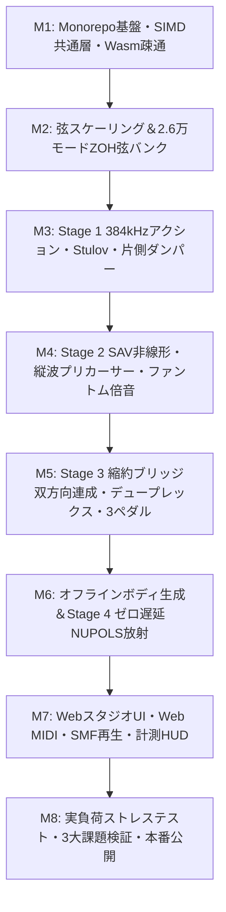

# 段階的開発マイルストーン＆モジュール分割計画 (`ROADMAP.md`)

本ドキュメントは [ARCHITECTURE.md](file:///home/likr/pianosim/docs/ARCHITECTURE.md) で定めた2層ハイブリッド物理モデリング音源を、全ファイル500行以下のCargo workspace＋Vanilla TypeScriptモノレポとして段階的に構築するための開発計画である。

---

## 1. Monorepo ディレクトリ＆クレート分割マップ（1ファイル500行上限）

全コードファイル（`.rs`, `.ts`, `.js`, `.css`）は **1ファイル最大500行以下**（設計目標120〜350行）を厳守し、肥大化の兆候がある場合は責務単位で即座にサブモジュール化する。

### 1.1 ルート＆ツールチェーン構成
- `Cargo.toml` — Cargo workspace定義（`resolver = "2"`, 10クレート、共通LTO/SIMDプロファイル、`<= 80行`）
- `.cargo/config.toml` — `wasm32-unknown-unknown` 用 `+simd128` ビルドフラグ定義（`<= 20行`）
- `package.json` — npm workspaces定義（`apps/web`, E2E・Wasmビルド統合スクリプト、`<= 60行`）
- `.github/workflows/ci.yml` — `check-lines` (500行上限検査) + `cargo test --workspace` + `clippy` + Wasm SIMD検査 + Playwright E2E（`<= 120行`）
- `.github/workflows/deploy.yml` — GitHub Pages（`apps/web/dist`）自動デプロイ（`<= 80行`）

### 1.2 Rust Workspace クレート分割（`crates/`）

| クレート | モジュール構成と責務（目安行数: 120〜350行 / 上限500行） |
|---|---|
| **`piano-simd`** | `lib.rs` (公開再エクスポート) / `f32x4.rs` (`wasm32` `simd128`・`x86_64` `avx2`・`aarch64` `neon`・スカラ統一4レーンSIMD型) / `aligned_buf.rs` (64B境界整列バッファ) / `fft_radix2.rs` (インプレースRadix-2 FFT) / `real_fft.rs` (実数FFT) / `lut_adaa.rs` (補間付きべき乗・逆導関数ADAAテーブル) |
| **`piano-spec`** | `lib.rs` / `events.rs` (サンプル正確MIDI 1.0/2.0 16bitイベント・3ペダル値) / `scale_design.rs` (88鍵230本弦スケーリング則) / `dispersion.rs` (解析的 $B(k)$・Railsbackストレッチ・決定論的微細偏差) / `voicing.rs` (ハンマー硬度・ユニゾン・弦長等のボイシング定数) / `preset_codec.rs` (バイナリプリセット読み書き) |
| **`piano-action`** | `lib.rs` / `oversample.rs` (接触中のみ局所8倍=384kHz更新制御) / `shank_timoshenko.rs` (1次Timoshenko柔軟シャンク) / `felt_stulov.rs` (Stulovヒステリシス緩和状態) / `k_method.rs` (無遅延ループ陰的解消＋ADAA位相補償) / `damper_pad.rs` (幾何クリアランス入力の片側ヒステリシス接触) / `pedals.rs` (連続ハーフペダル・ソステヌートラッチ・ウナコルダ軸シフト) |
| **`piano-strings`** | `lib.rs` / `choir_map.rs` (88鍵↔230弦×2偏波マップ) / `modal_soa.rs` (~2.6万モード `align(64)` SoA平面配列) / `zoh_kernel.rs` (分散ゼロZOH 2次IIR SIMD更新核) / `sav_drift.rs` (Risse DAFx 2025 パワーバランス保存ドリフト制御SAV) / `longitudinal.rs` (縦波プリカーサー先行結合) / `phantom.rs` (強制偶数・奇数次ファントム倍音) |
| **`piano-bridge`** | `lib.rs` / `hertz_contact.rs` (Hertz弦・駒接触剛性) / `admittance_ssm.rs` (5〜12モード縮約響板アドミタンス状態空間) / `duplex.rs` (デュープレックス・スケール弦共鳴モード) / `zone_proj.rs` (全230弦の8ブリッジゾーンへの空間重み射影) |
| **`piano-body-gen`** | `lib.rs` / `orthotropic_plate.rs` (2次元直交異方性響板＋ダウンベアリング剛性) / `ribs_rim.rs` (肋木・駒不均質性・木製リム支持・鋳鉄フレーム結合) / `air_cavity.rs` (3次元空気室・大屋根反射連成) / `pole_cancel.rs` (縮約ブリッジ極抽出＋放射留数の極除去逆フィルタ) / `bake.rs` / `bin/bake_preset.rs` (プリセットバイナリ生成CLI) |
| **`piano-radiator`** | `lib.rs` / `ir_synth.rs` (44.1/48/96kHz動的IR生成) / `mic_perspectives.rs` (奏者・近接・客席3視点定義) / `binaural_hrtf.rs` (ヘッドホン用バイノーラルHRTF) / `fir_head.rs` (先頭64タップゼロ遅延SIMD FIR) / `partitioned_fft.rs` (NUPOLS非一様分割FDL畳み込み) / `limiter.rs` (安全出力リミッタ) |
| **`piano-engine`** | `lib.rs` / `engine.rs` (Stage 1〜4統合、ゼロアロケーション `render_block`) / `event_queue.rs` (固定長サンプル正確イベント分割) / `param_smooth.rs` (リアルタイムボイシング平滑更新) / `telemetry.rs` (処理時間・ブリッジエネルギー計測) |
| **`piano-wasm`** | `lib.rs` / `ring_ipc.rs` (AudioWorklet線形メモリ内SPSCコマンド/テレメトリリング) / `exports.rs` (`wasm-bindgen` 最小エクスポート境界) |
| **`piano-cli`** | `main.rs` / `wav_writer.rs` (32bit float / 24bit WAV書き出し) / `bench_rt.rs` (64サンプル@48kHz p99コールバックベンチ) / `scenarios.rs` (音響・物理検証スイート) / `check_lines.rs` (500行上限＋ライセンス/FTO禁止語句静的検査) |

### 1.3 Webアプリケーション分割（`apps/web/`）
- `src/main.ts` — アプリ起動とモジュール結合
- `src/audio/` — `worklet-processor.ts` (AudioWorklet Wasm駆動) / `wasm-host.ts` (初期化・SPSC送信・ボイシング反映) / `telemetry-client.ts` (p99・スペクトルデータ受信)
- `src/midi/` — `web-midi.ts` (Web MIDI 1.0/2.0入力＋連続CC64/66/67) / `smf-parser.ts` (Standard MIDI File `.mid` パーサ) / `midi-player.ts` (高精度スケジューラ) / `demo-scores.ts` (内蔵デモ楽曲生成)
- `src/input/` — `pointer-glissando.ts` (マルチタッチ・グリッサンド) / `pc-keyboard.ts` (PCキーボード演奏・リピート抑止) / `pedal-controller.ts` (3ペダル・連続ハーフペダルUI操作)
- `src/ui/` — `app-shell.ts` / `keyboard-view.ts` (88鍵盤描画) / `pedal-bar.ts` / `voicing-panel.ts` (ハンマー硬度・ユニゾン・ストレッチ・弦長) / `space-panel.ts` (大屋根開閉・4聴取視点) / `transport-bar.ts` (デモ再生・MIDIファイル読込)
- `src/viz/` — `spectrum-canvas.ts` (60fps FFTスペクトル描画) / `perf-meter.ts` (p50/p99処理時間・過負荷警告HUD)
- `src/styles/` — `base.css` / `keyboard.css` / `panels.css`
- `e2e/` — `boot-worklet.spec.ts` / `keyboard-glissando.spec.ts` / `pedals-voicing.spec.ts` / `midi-playback.spec.ts` / `perf-stability.spec.ts`

---

## 2. マイルストーン依存関係

### 2.5 Swarm並列実装・Worktreeコミット・マイルストーンPush原則
- 全マイルストーンの実装は [SWARM_WORKFLOW.md](file:///home/likr/pianosim/docs/SWARM_WORKFLOW.md) および [AGENTS.md](file:///home/likr/pianosim/.agents/AGENTS.md) に従い、`workspace:"share"` の独立Git worktreeを持つ `author` 群と `workspace:"inherit"` の `verifier`・`integrator` で分業する。
- **Pre-M1保全タグ**: M1で旧v1 TypeScript実装を削除する直前に、現行 `c75cf57` へ `v0.1.0-ts-dwg` タグを打刻し、D7の比較フォールバック経路を保全する（[DECISIONS_AND_FALLBACKS.md](file:///home/likr/pianosim/docs/DECISIONS_AND_FALLBACKS.md)）。
- **コミット・Pushゲート**: 各 `author` は `share` worktree内の論理単位でConventional Commitsを積み、**マイルストーン途中の `git push` は行わない**。各マイルストーンの検収基準（Gate）を `verifier` が承認し、`integrator` が `main` 統合および `.agents/AGENTS.md` への学びの統合・剪定を完了した時点で、マイルストーンごとに1回だけ `git tag m<N>` ＋ `git push origin main --tags` を実行する。

---

## 3. 段階的マイルストーン詳細（M1〜M8）

### M1：旧コード一掃・Rust/Web Monorepo基盤・SIMD共通層・Wasm AudioWorklet疎通
- **目的・スコープ**: `v0.1.0-ts-dwg` タグ打刻後にv1 TypeScript実装（旧 `src/`, `tests/`, 旧設定）を完全に削除して白紙から新Monorepoを構築し、`piano-simd`・`piano-wasm`・`AudioWorklet` の最小垂直貫通（テスト用正弦波・単一モード発音）とCI自動検査を確立する。
- **対象クレート／モジュール**: ルート構成、`.github/workflows/{ci,deploy}.yml`、`piano-simd`（全ファイル）、`piano-spec/{lib,events}.rs`、`piano-engine/{lib,engine,event_queue}.rs`、`piano-wasm`、`piano-cli/{main,wav_writer,check_lines}.rs`、`apps/web/src/{main.ts,audio/*,ui/app-shell.ts}`。
- **主要実装タスク**:
  1. 旧v1コードを除去し、Cargo workspace + npm workspaces + Vite（`base: /pianosim/`）を新規初期化。
  2. `piano-simd::F32x4`（`wasm32` `simd128`／ネイティブSIMD／スカラ）および64B境界整列バッファ・Radix-2/実数FFT・`lut_adaa.rs` 基盤を実装。
  3. `piano-cli check-lines` による「全ソースファイル500行上限＆AGPL/禁止パターン検査」を実装。
  4. `AudioWorklet` 上でのWasmロード・SPSCイベント投入・WAV書き出し経路を疎通。
- **客観的検収基準（Gate）**:
  - `cargo test --workspace` 全件パス、`piano-cli check-lines` で全ファイル `<= 500` 行を確認。
  - 生成 `.wasm` にWasm SIMD命令（`v128`）が含まれることを `wasm-objdump` / バイト列検査で確認。
  - Playwright Headless Chromiumにてコンソールエラー0件で `AudioWorklet` 発音とテスト波形出力を確認し、GitHub Pagesへ基盤デプロイ成功。

### M2：コンサートグランド弦設計スケーリング＆全2.6万モードZOH剛性弦バンク常時SIMD駆動
- **目的・スコープ**: 全88鍵・230本・約2.6万モードのピアノ弦バンクを構築し、SIMD並列ループで毎サンプル常時駆動できる計算基盤とチューニング精度を確立する。
- **対象クレート／モジュール**: `piano-spec/{scale_design,dispersion}.rs`、`piano-strings/{lib,choir_map,modal_soa,zoh_kernel}.rs`、`piano-cli/bench_rt.rs`。
- **主要実装タスク**:
  1. 88鍵・230本（単弦8・複弦18・3本組62）の $F_0, B(k)$ 設計則、自動Railsbackストレッチ調律、決定論的な鍵・弦ごとの微細偏差（有機的揺らぎ）を実装。
  2. 20 kHz以下全可聴横モード（垂直・水平2偏波：約23,514モード）＋縦自由モード（約1,670モード）＝計約26,184モードを `#[repr(align(64))]` SoA配列（約490 KB）へ展開。
  3. 数値分散ゼロのZOH 2次モード更新式を分岐なし `F32x4` カーネルとして実装（M2時点はテスト用インパルス／ガウス励振で駆動）。
- **客観的検収基準（Gate）**:
  - 44.1 / 48 / 96 kHz各サンプルレートで、A0〜C8全音域の部分音ピーク周波数誤差が理論値 $j F_0 \sqrt{1 + B j^2}$ に対し **0.05 cents未満**。
  - `piano-cli bench` およびブラウザ内 `AudioWorklet` にて全約2.6万モード常時更新が128サンプル（2.67 ms @ 48 kHz）予算内に余裕をもって収まること。
  - FFT・エンベロープ解析により、垂直／水平2偏波の減衰差とトリコード弦間のうなりを定量確認。

### M3：Stage 1 局所384 kHzアクション系（Timoshenkoシャンク・Stulovヒステリシス・K-method/ADAA・片側ダンパー）
- **目的・スコープ**: テスト用励振を廃し、打鍵の連続ダイナミクス・連打時のフェルト記憶効果・連続ダンパー減衰を物理モデル化する。
- **対象クレート／モジュール**: `piano-action/{lib,oversample,shank_timoshenko,felt_stulov,k_method,damper_pad,pedals}.rs`。
- **主要実装タスク**:
  1. 接触中（$\Delta y > 0$）ノートのみホスト8倍（384 kHz＠48 kHz）で更新する局所マルチレート・スケジューラを実装。
  2. 1次Timoshenko柔軟シャンクと、1次IIR緩和状態（離鍵後も状態を保持）を持つStulovヒステリシス接触力を実装。
  3. BorinのK-method（無遅延ループ解消）とルックアップテーブルADAA（0.5サンプル群遅延補償付き）を統合。
  4. 粘性テーブル書き換えを排した「幾何学的クリアランス入力・片側ヒステリシス接触ダンパーパッド」を実装。
- **客観的検収基準（Gate）**:
  - 16ビットベロシティ掃引（`pp`〜`fff`）で出力RMSが単調増加（ダイナミックレンジ $\ge 24\text{ dB}$）し、スペクトル重心が上昇かつナイキスト折り返しノイズが抑圧されていること。
  - 秒間12回の同音高速連打（ribattuto）において、Stulov緩和状態保持による非一様な打弦パルス変化（メモリレス比の有意差）を検証。
  - ハーフペダル開度（`0.0 / 0.5 / 1.0`）およびリペダリングで高次倍音の選択的減衰を確認。16音同時最大強打で NaN/Inf 0件。

### M4：Stage 2 非線形弦拡張（パワーバランス保存ドリフト制御SAV・縦波プリカーサー・ファントム倍音）
- **目的・スコープ**: 強打時の張力変調・ピッチグライド、縦波先行アタック、および低音域の重厚なファントム倍音を実装し、アタック遊離感と線の細さの核を解消する。
- **対象クレート／モジュール**: `piano-strings/{sav_drift,longitudinal,phantom}.rs`。
- **主要実装タスク**:
  1. Risse, Hélie & Bilbao（DAFx 2025）に基づくパワーバランス保存型ドリフト制御SAV法（$r = \sqrt{2E_{nl}(q) + C_0}$＋摂動制御 $g_{\text{mod}}$）を強打弦（低〜中音域）のモード更新へ結合。
  2. ブリッジ傾斜角を通じた縦波プリカーサー伝達と、Bank & Sujbert型の非線形強制応答（偶数次 $2f_m$・奇数次 $f_n \pm f_m$ ファントム・パーシャル）を実装。
- **客観的検収基準（Gate）**:
  - 無減衰テスト条件下で離散ハミルトニアン保存誤差 $\Delta H / H < 10^{-5}$、減衰ありで厳密受動性（エネルギー単調非増加）を確認。
  - A0〜C3における100回連続 `ff` 再打弦後の基本周波数ドリフトが **0.5 cents未満**。
  - 低音弦強打波形にて横波主パルスより先行到達する縦波プリカーサー成分と、`ff` スペクトル上の $2f_m, f_n \pm f_m$ ファントム倍音ピークを検出。

### M5：Stage 3 双方向縮約ブリッジ連成・デュープレックス弦・3ペダル完全創発
- **目的・スコープ**: 全230弦・デュープレックス弦・縮約響板モードを単一の双方向状態空間で結合し、二段階減衰と全開放弦シンパセティック共鳴を自然創発させる（FTO完全準拠）。
- **対象クレート／モジュール**: `piano-bridge/{lib,hertz_contact,admittance_ssm,duplex,zone_proj}.rs`、`piano-action/pedals.rs`（ウナ・コルダ／ソステヌート連携）。
- **主要実装タスク**:
  1. Hertz接触剛性 $k_c$ と5〜12モードの縮約響板アドミタンス状態空間を介して、全230弦＋デュープレックス弦を条件分岐なしで双方向結合。
  2. ウナ・コルダのアクション横シフト（3→2本／2→1本打撃＋非打撃弦のブリッジ経由吸収）およびソステヌート選択保持を結合。
- **客観的検収基準（Gate）**:
  - 初期高速減衰と後続緩減衰からなる明瞭な「二段階減衰カーブ」を確認。
  - Lehtonenら（JASA 2007）の共鳴基準（ペダル踏込時に1〜5秒区間の背景共鳴残差エネルギーが約8〜12 dB上昇し、C4の $T_{60}$ が有意に伸長する一方、C2/C6は過度に発散しない）をクリア。
  - 倍音関係条件分岐なしで無音押鍵（サイレントキー）へのシンパセティック共振、ウナ・コルダ時の非打撃弦励振と軟化、ソステヌートの選択持続を実証。

### M6：オフライン構造音響ボディ生成＆Stage 4 ゼロ遅延8ゾーン非一様分割FFT畳み込み放射器
- **目的・スコープ**: Rustオフライン物理シミュレーションからボディ固有モードを焼き込み、初期化時動的IR合成＋ゼロ遅延NUPOLS畳み込みにより木製胴鳴りと空間定位を完成させる。
- **対象クレート／モジュール**: `piano-body-gen`（全モジュール＋`bake_preset.rs`）、`piano-spec/{voicing,preset_codec}.rs`、`piano-radiator`（全モジュール）、`piano-engine/{param_smooth,engine}.rs`。
- **主要実装タスク**:
  1. `piano-body-gen` で異方性響板＋肋木＋木製リム＋3次元空気室＋鋳鉄フレーム＋大屋根反射の固有モード（1,000〜2,000極・留数）を計算し、縮約ブリッジ極を除去して数百KBのプリセットバイナリを生成。
  2. `piano-radiator::ir_synth` でホスト実レート（44.1/48/96 kHz）、4聴取視点（奏者・近接・客席・バイノーラルHRTF）、大屋根開閉（全開/半開/閉）に応じた9ゾーン×L/R（8ブリッジ＋1棚板）の0.5秒IRを数十msで合成。
  3. 先頭64サンプル直接SIMD FIR（遅延0）＋後続非一様分割FFT畳み込み（NUPOLS）と棚板衝撃（keybed thump）注入、およびリアルタイム・ボイシング再計算（ハンマー硬度・ユニゾン・ストレッチ・弦長）を実装。
- **客観的検収基準（Gate）**:
  - Stage 3 + Stage 4直列接続時に二重共振ピークが発生しないこと。
  - NUPOLS出力と時間領域直接畳み込み参照値の差分RMSが **-100 dB以下**、かつアルゴリズム追加遅延 **0サンプル**。
  - 44.1 / 48 / 96 kHz間のスペクトル包絡整合性、大屋根3状態・バイノーラルITD/ILD・高音強打時の棚板低域衝撃の差異を確認。プリセットサイズ **500 KB未満**。

### M7：クリーン設計WebスタジオUI・Web MIDI・SMFデモ再生・ボイシング＆リアルタイム計測HUD
- **目的・スコープ**: 新設計のVanilla TypeScript + Vite Webアプリを完成させ、演奏・MIDI再生・ボイシング編集・リアルタイム負荷＆スペクトル可視化を統合する。
- **対象クレート／モジュール**: `apps/web/src/**`（`audio/`, `midi/`, `input/`, `ui/`, `viz/`, `styles/`）および `apps/web/e2e/*.spec.ts`。
- **主要実装タスク**:
  1. レスポンシブ88鍵盤（マルチタッチ・グリッサンド）、PCキーボード入力（リピート抑止・オクターブ移動）、連続ハーフペダルUIを含む3ペダル操作を実装。
  2. Web MIDI API（14/16bitベロシティ・連続CC64/66/67）と、`.mid` パーサ＆内蔵デモ曲プレイヤを実装。
  3. ボイシング／空間パネル（ハンマー硬度・ユニゾン揺らぎ・ストレッチ調律・弦長・大屋根・4聴取視点）および60fpsスペクトル＆AudioWorklet p99負荷HUDを実装。
- **客観的検収基準（Gate）**:
  - Playwright E2E全スイートが実Wasm `AudioWorklet` 上で100%パス（88鍵、グリッサンド、連続ペダル、演奏中ボイシング・大屋根・視点切替時のクリックノイズ/NaN 0件、SMFデモ再生、Web MIDI模擬入力、コンソールエラー0件）。

### M8：実負荷ストレステスト・3大聴覚課題ベンチマーク・最終最適化＆本番公開
- **目的・スコープ**: 高負荷演奏下でのp99テールレイテンシと3大課題解消の客観検証を完了し、GitHub Pages本番公開を行う。
- **対象クレート／モジュール**: `piano-strings` / `piano-radiator` / `piano-action` ホットパス最適化、`piano-cli/{bench_rt,scenarios}.rs`、`.github/workflows/{ci,deploy}.yml`。
- **主要実装タスク**:
  1. Balasubramaniam（DAFx 2026）型の高密度和音・アルペジオSMF＋連続ペダルポンピング＋ライブボイシング変更の複合負荷ベンチマークを実施し、SIMDホットパスを最適化。
  2. 3大課題（強打チャープとボディの初期時間統合、12 Hz連打のヒステリシス揺らぎ、低中域の持続胴鳴り密度）の客観的音響検証レポートを `piano-cli scenarios` で自動出力。
  3. 全ファイルの500行上限・FTO検査・`clippy -D warnings`・全テストを通過させ、GitHub Pages本番デプロイと稼働確認を完了。
- **客観的検収基準（Gate）**:
  - ネイティブCLI 64サンプル＠48 kHzコールバックの **p99処理時間が期限（1.33 ms）の50%（0.66 ms）以下**、かつブラウザ128サンプル `AudioWorklet` での連続SMF負荷時にオーディオアンダーラン0件。
  - `cargo clippy --workspace -- -D warnings`・`cargo test --workspace`・Playwright E2E・`piano-cli check-lines`（全ファイル `<= 500` 行）全件パス、公開URL稼働確認完了。
