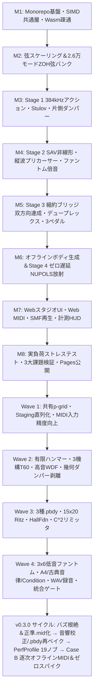

# 段階的開発マイルストーン＆モジュール構成マップ (`ROADMAP.md`)

本ドキュメントは [ARCHITECTURE.md](ARCHITECTURE.md) で定めた2層物理モデリングピアノ音源のモノレポ構成・クレート分割、および M1〜M8 ＋ Wave 1〜4 ＋ `v0.3.0` サイクルの実装概要を記録する。

---

## 1. Monorepo ディレクトリ＆クレート構成マップ（1ファイル500行上限）

全ソース・設定・設計ファイル（`.rs`, `.ts`, `.js`, `.css`, `.md`）は **1ファイル最大500行以下** を厳守し、肥大化時は責務単位でサブモジュール化する。

### 1.1 ルート＆CI/CD構成
- `Cargo.toml` — Cargo workspace（`resolver = "2"`, 10クレート、`[profile.dev]` `opt-level = 2, debug = 1` 統一、`[profile.release]` `opt-level = 3, lto = "fat", codegen-units = 1, panic = "abort"`）
- `.cargo/config.toml` — `wasm32-unknown-unknown` 用 `+simd128,+bulk-memory,+nontrapping-fptoint,+sign-ext` フラグ定義
- `package.json` — npm workspaces（`apps/*`, `build`, `build:wasm`, `build:web`, `preview`, `test:e2e`, `bench:web`）
- `.github/workflows/ci.yml` — Rust `1.97.1` + `Swatinem/rust-cache@v2`、`cargo fmt --check`、`piano-cli check-lines`（500行上限・クリーンルーム・E2E `waitForTimeout` 禁止）、`clippy`（workspace + `wasm32`）、`cargo test --workspace`、`npm run build`、`piano-cli check-wasm-simd`、Playwright Chromium E2E
- `.github/workflows/deploy.yml` — `workflow_run`（`CI` の `main` push 成功時のみ発火）による GitHub Pages（`apps/web/dist`）自動デプロイ

### 1.2 Rust Workspace クレート分割（`crates/`）

| クレート | モジュール構成と主な責務（各ファイル `<= 500` 行） |
|---|---|
| **`piano-simd`** (`no_std`) | `lib.rs` / `f32x4.rs` + `f32x4_{wasm,x86,neon,scalar}.rs` / `aligned_buf.rs` (64B整列) / `fft_radix2.rs` / `real_fft.rs` / `split_complex.rs` / `lut_adaa.rs` (区分エルミート ADAA LUT) / `poly_adaa.rs` (`PolyPowerApprox` 6次 Bernstein 多項式 ADAA) / `math.rs` |
| **`piano-spec`** (`no_std`) | `lib.rs` / `events.rs` (16bit `SampleEvent`・3ペダル) / `scale_design.rs` (88鍵230本) / `dispersion.rs` + `dispersion_tuning.rs` (解析的 $B(k)$, Railsback ストレッチ, `C5+` デチューンテーパ) / `perf_profile.rs` (`PerfPreset::{Full,Balanced,Realtime}`, 19ノブ POD `PerfProfile`) / `voicing.rs` (`VoicingSpec`, `NoteVoicingOffset[88]`) / `temperament.rs` (古典4音律) / `condition.rs` (`SplitMix64` 経年変化) / `preset_codec.rs` (`PIANOBOD` CRC-32付) |
| **`piano-action`** (`no_std`) | `lib.rs` / `action_bank_ops.rs` / `oversample.rs` (`2/4/8x` 可変マルチレート) / `decimation_fir.rs` / `agraffe_delay.rs` (`AgraffeDelayLine` 短弦反射) / `shank_timoshenko.rs` / `felt_stulov.rs` / `k_method.rs`, `k_method_poly.rs` / `p_grid.rs` (共有24点 $p$-grid 384KB) / `damper_pad.rs`, `damper_pad_simd.rs` (`DamperPadSoa` `464`-padded `116x4` SoA + 間引き), `damper_pad_symp.rs` / `pedals.rs`, `pedals_clearance.rs` (間引きクリアランス/剥離補間) / `keybed.rs` (打鍵/離鍵 Zone 8) / `math.rs` |
| **`piano-strings`** (`no_std`) | `lib.rs` / `choir_map.rs` / `modal_soa.rs` (~26,184モード `align(64)` SoA) / `zoh_kernel.rs`, `zoh_subblock.rs` / `damping_law.rs` (3機構 $T_{60}$) / `action_driver.rs` / `contact.rs`, `contact_phi.rs` (動的 $\Phi_w(j)$・`damper_phi` ロールオフ), `contact_ports.rs`, `contact_port_sync.rs` / `sav_{drift,spec,kernels,pair,pair_tile,tile,tile_3x6}.rs` / `longitudinal.rs` / `phantom.rs`, `phantom_3x6.rs`, `phantom_sparse.rs` (`2x2` 疎ファントム) / `bridge_{coupled,port,port_build,flush,tail_routing,prefix_math,prefix_step,prefix_wdf,kernels,damp_kernels,open_kernels,sample_prep,sav,tails,zones,diag}.rs` / `bank_energy.rs`, `bank_profile.rs` / `voicing_blob.rs`, `voicing_blob_install.rs`, `voicing_blob_sav.rs`, `voicing_update.rs` / `math.rs` |
| **`piano-bridge`** (`no_std`) | `lib.rs` / `hertz_contact.rs` (SAV保守型 Hertz 接触) / `admittance_ssm.rs`, `admittance_smooth.rs` (`4..=10` 可変極・滑らか射影) / `bridge_presets.rs` / `bridge_step.rs` / `duplex.rs` (調律連動64モード `DuplexBank`) / `zone_proj.rs` (8ゾーン射影) / `math.rs` |
| **`piano-body-gen`** | `lib.rs` / `types.rs` / `presets.rs`, `preset_bodies.rs` (3種物理ボディ定義・文献モビリティ校正) / `orthotropic_plate.rs`, `plate_assembly.rs` (`15×20` Ritz クラウン単極子/2D面積分/統計Rayleigh拡張) / `ribs_rim.rs` / `air_cavity.rs` / `linalg.rs`, `linalg_eigen.rs` / `pole_cancel.rs`, `pole_cancel_sim.rs` (10極厳密極除去) / `bake.rs`, `bin/bake_preset.rs` (+ `multi_body_parity.rs` 符号不変パリティ検査) |
| **`piano-radiator`** (`no_std`) | `lib.rs` / `bank_config.rs` / `body_assets.rs` (`1,287〜1,338` モード `.pbdy` 3種) / `ir_synth.rs`, `velvet_tail.rs` (適応18経路 IR + `3.8 kHz` HPF ベルベットテール) / `modal_prepare.rs`, `modal_synth.rs`, `subrate_upsample.rs`, `pole_cancel_filter.rs` / `mic_perspectives.rs`, `binaural_hrtf.rs` / `fir_head.rs`, `block_fft_head.rs` (`BlockFftHead`) / `partitioned_fft.rs`, `partitioned_schedule.rs`, `nupols_tier.rs`, `nupols_tier_ops.rs`, `nupols_collapse.rs` (因果RMSステレオ集約) / `space_blob.rs`, `space_blob_install.rs` (`SpaceBlob` v2) / `hall_fdn.rs`, `hall_hadamard.rs` (`4/8/16` ライン) / `limiter.rs` ($C^2$ 安全リミッタ) / `math.rs` |
| **`piano-engine`** | `lib.rs` / `engine.rs`, `engine_core.rs`, `drivers.rs` (Stage 1〜4統合) / `event_queue.rs` / `param_smooth.rs` / `perf_control.rs` / `space_control.rs`, `space_guard.rs` / `voicing_commit.rs` (11ブロック漸進コミット) / `diag.rs` / `telemetry.rs` |
| **`piano-wasm`** | `lib.rs` / `ring_ipc.rs` / `prep_ipc.rs` / `exports.rs`, `perf_exports.rs` (19ノブ Perf C-ABI), `wave3_exports.rs`, `wave4_exports.rs` |
| **`piano-cli`** | `main.rs` / `cli_profile.rs` (`--perf-profile` + 19上書きフラグ) / `smf_parser.rs` / `render_cmd.rs`, `render_presets.rs` / `wav_writer.rs` / `bench_rt.rs`, `bench_composite.rs`, `bench_prep.rs` (Half-pedal+Prep分離) / `diag/{mod,radiator,bridge,hammer,buzz}.rs` / `scenarios/` (`mod.rs`, `f0_estimator.rs`, `spectral_utils.rs`, `challenge1..4`) / `wasm_check.rs` / `check_lines.rs` |

### 1.3 Webアプリケーション分割（`apps/web/`）
- `vite.config.ts` (`?worklet`/`?blobworker` `esbuild` 自己完結バンドル, `base: '/pianosim/'`) / `playwright.config.ts` (`functional` 並列 + `perf-stability` 直列 on `vite preview`) / `bench/{wasm-bench,bench-direct-wasm,bench-live-worklet}.js`
- `public/demos/*.mid` — 正準 Format-0 `.mid` デモ6曲（`01-bach-prelude-bwv846.mid` 〜 `06-rachmaninoff-prelude-op3-no2.mid`）
- `src/main.ts` — アプリ起動とサブシステム結合
- `src/audio/` — `abi.ts` / `perf-abi.ts` / `perf-sync.ts` / `offline-abi.ts` / `offline-render-worker.ts` / `offline-renderer.ts` / `offline-stream-player.ts` / `offline-worker-client.ts` / `wasm-loader.ts` / `pipeline-bootstrap.ts` / `blob-streamer.ts` (`2,048` float 直書き) / `prep-worker.ts` / `worklet-processor.ts` / `worklet-wasm-init.ts` / `worklet-telemetry.ts` / `worklet-recorder.ts` / `wav-recorder.ts` / `wasm-host.ts` / `telemetry-client.ts`
- `src/midi/` — `web-midi.ts` / `smf-parser.ts` / `demo-scores.ts`（`public/demos/*.mid` 読込）
- `src/input/` — `pointer-glissando.ts` / `pc-keyboard.ts` / `pedal-controller.ts` / `touch-curve.ts`
- `src/presets/` — `parameter-presets.ts`（4音色プリセット）
- `src/ui/` — `app-shell.ts` / `app-input-router.ts` / `shell-template.ts` / `keyboard-view.ts` / `pedal-bar.ts` / `preset-bar.ts` / `perf-panel.ts` / `voicing-panel.ts` / `space-panel.ts` / `touch-curve-selector.ts` / `transport-bar.ts` / `recorder-controls.ts`
- `src/viz/` — `spectrum-canvas.ts` / `perf-meter.ts`
- `src/styles/` — `base.css` / `keyboard.css` / `hud.css` / `panels.css` / `presets.css`
- `e2e/` — `helpers/{audio-diag,midi-helpers,offline-helpers}.ts`（3ヘルパー）および13本の Playwright E2E スペック（`boot-worklet`, `concert-pitch`, `demo-scores`, `keyboard-glissando`, `midi-playback`, `offline-stream-unit`, `parameter-presets`, `pedals-voicing`, `perf-profile`, `perf-stability`, `space-reverb`, `wave4-features`, `webmidi-touch`）

---

## 2. 開発マイルストーン＆品質拡張フェーズ全体フロー

旧 v1 TypeScript 実装は Git タグ `v0.1.0-ts-dwg` へ保全し、M1〜M8（基盤構築）、Wave 1〜4（音響・表現力・信頼性拡張）、および `v0.3.0` サイクル（接触バズ修正・音響校正・`PerfProfile`・逐次オフライン MIDI）を順次完了した。

---

## 3. 基盤マイルストーン実績（M1〜M8）

| Phase | スコープ概要 | 主な達成・検証ゲート |
|---|---|---|
| **M1** | Rust/Web Monorepo基盤、`piano-simd::F32x4`、Radix-2/Real FFT、Wasm AudioWorklet最小疎通 | `check-lines`（<=500行/FTO検査）、`0 imports` `+simd128` 検証、CI/Pages基盤構築 |
| **M2** | 88鍵・230本スケーリング則、約26,184モード `align(64)` SoA、分散ゼロ ZOH SIMD カーネル | 44.1/48/96 kHz 全域で部分音周波数誤差 `<= 0.00257 cents`（目標 `< 0.05`） |
| **M3** | 局所8x（384 kHz）Timoshenkoシャンク、2時定数 Stulov、K-method+ADAA、460 V/H 片側ダンパー | `pp`〜`fff` 単調増加（`>= 24 dB`）、12 Hz 連打メモリ効果、ハーフペダル選択減衰 |
| **M4** | ドリフト制御SAV（DAFx 2025）、縦波プリカーサー、強制ファントム倍音、エネルギー地平線縮退 | 無減衰ハミルトニアン保存 `< 1e-5`、100回 `ff` 連打ドリフト `< 0.5 cents` |
| **M5** | 10極縮約ブリッジ `8×8` WDF双方向連成、Hertz接触、`DuplexBank`、Una Corda/Sostenuto創発 | 二段階減衰・Lehtonen共鳴ゲイン・無音押鍵共振を分岐ゼロで実証 |
| **M6** | `piano-body-gen` 固有値解析＆極除去、18経路適応IR＋64-tap 0遅延 FIR＋Staggered NUPOLS | 極除去誤差 `<= 1e-4 dB`、直接畳み込み差分 `<= -130.28 dB`、遅延0サンプル |
| **M7** | Vanilla TS WebスタジオUI、Prep Web Worker 分離、`48 kHz` 固定化、SMF/Web MIDI、HUD | 実 Wasm `AudioWorklet` 上での E2E 貫通、Prep Worker 非同期転送による `0 ms` 停止 |
| **M8** | `piano-cli scenarios`（3大課題）、`bench` / `bench:web` 負荷検証、GitHub Pages本番デプロイ | 64サンプル＠48kHz p99 `< 0.66 ms`、ブラウザ連続負荷アンダーラン0件、Pages稼働 |

---

## 4. 品質・表現力拡張フェーズ実績（Wave 1〜4 & CI/E2E 最適化）

- **Wave 1 (`I-1..I-5`)**: 共有 `staging` 直列化 `BlobStreamer`＋境界ガード、7→16bit正規化（`u7ToU16`/`cc7ToU16`）＋Touch Curve（`Light`/`Natural`/`Heavy`）、`EventQueue` キャリーオーバ、Web MIDI 連続 CC67 Una Corda 一本化、共有24点 $p$-グリッド `PGridLuts`（384 KB）を実装。
- **Wave 2 (`II-1..II-5`)**: 有限ハンマー幅空間窓 $\Phi_w(j)$ ＋打弦比 $\beta(k)$ ＋区分エルミート `AdaaPowerLut`、高音 `6 kHz` WDF 再接続＋`C5+` ユニゾンデチューンテーパ、`damping_law.rs` 3機構 $T_{60}(k, j)$、調律連動 `DuplexBank`（`< 1e-20` フラッシュ）、幾何ダンパー段階剥離（`MAX_PEEL_SLOTS = 24`）＋離鍵 Zone 8 衝撃＋FIR `prev_sub_forces` 保持を実装。
- **Wave 3 (`III-1..III-4`)**: 6-tap ER＋`8×8` Hadamard `HallFdn`（`< 400 Hz` IACC シェルビング）、3種 `.pbdy` ボディ（`ConcertGrand` / `UprightStudio` / `VintageSaloon`）、`15×20` Ritz ソルバ＋`3.8 kHz` HPF ベルベットテール、および 0遅延 $C^2$ `StereoLimiter` を統合。
- **Wave 4 (`II-6, IV-1..IV-3`) & 信頼性改善**: 低音 `k=0..16` `3×6`（`12×24`）ファントムカーネル、A4 `392.0..466.2 Hz`・古典4音律・`SplitMix64` `Condition`、デモ6曲ヒューマナイズ・ポインタY座標ベロシティ・24-bit TPDF / 32-bit float WAV 録音（`WorkletRecorderPool`）、joint LS `f0_estimator.rs` と Stage 4 統合ゲート（ISO-226 / IACC / `ff` IMD）、符号不変 `.pbdy` パリティ検査、`waitForPrepIdle` による E2E 決定論的同期（`waitForTimeout` 全廃・`check-lines` 静的禁止）、`CI` 成功ゲート付き `deploy.yml` を確立した。

---

## 5. 品質向上・`PerfProfile`・逐次オフライン MIDI サイクル（`v0.3.0`）

Wave 4 完了後、実聴音響課題の根治と Web 実時間性能・品質両立に向けて以下の 4 段階サイクルを実施した：

1. **接触バズ根絶＆正準 `.mid` 移行（`0ccf9b7`）**:
   - `damper_phi` への静的空間幅・`2.6 kHz` 粘弾性ロールオフ導入、`engage` 乗算修正、位相不変ハーフペダルテールにより全6曲 `.mid` の非打弦 `3–12 kHz` バズバースト `0` 回を達成。
   - 手続き的スコア生成を撤廃し、`apps/web/public/demos/*.mid` の正準 Format-0 `.mid` 6曲＋共有 `smf_parser.rs`/`smf-parser.ts` 構成へ統一。
2. **Stage 1–4 音響校正＆ `.pbdy` 再ベイク（`d2dab9c`）**:
   - `piano-body-gen`: クラウン初期曲率単極子・全2D板面積分・Helmholtz 空気室・駒ピン線積分ロッキング・`-3〜-4 dB/oct` 放射傾斜を反映し 3種 `.pbdy` を再ベイク（`1,338` / `1,287` / `1,297` モード）。
   - Stage 1–3: `THERMOELASTIC_COEFF` 緩和（`2.05e-9`）、動的圧縮深さ $\Phi_w(j)$、低音 `3×6` と `F2..G4` 縦モード再配分、`8x` `AgraffeDelayLine` 導入、低中域 Stulov $p$ 軟化、文献モビリティ校正・既定微小ユニゾン偏差・V/H ピン角差・`BridgeBank::set_fixed_end` 実装、および CLI 診断コマンド `diag-{radiator,bridge,hammer,buzz}` を追加。
3. **`PerfProfile` 19ノブパラメータ化＆ P0/P1 最適化（`510ab81`）**:
   - 19パラメータ POD `PerfProfile`（`Full` / `Balanced` / `Realtime`）を `piano-spec`〜`piano-cli` / `piano-wasm` / Web `PerfPanel` へ貫通実装。
   - `PolyPowerApprox`（6次 Bernstein 多項式 ADAA）、`phantom_sparse.rs`（`2×2` 疎ファントム）、`active_bridge_poles`（`4..=10` 滑らか射影）、`BlockFftHead` ＋ 因果 RMS 整合ステレオ集約 `nupols_collapse.rs`、`SpaceBlob` v2（`SPACE_BLOB_MAGIC_V2`）を実装。
4. **ネイティブ/Web RT 校正・Case B 逐次オフライン MIDI・ゼロスパイク刷新（`48045f5`〜`v0.3.0`）**:
   - ライブ試奏（`AudioWorklet`, 既定 `Balanced`）とオフライン MIDI 再生（`offline-render-worker.ts` ＋ `OfflineStreamPlayer`, `1.5 s` 初回＋`0.75 s` チャンク, `Full` 品質＋WAV 書き出し）の 2 系統実行へ移行。
   - `BlobStreamer` `2,048` float 転送＋`piano_space_chunk_ptr` スタンバイ直接書き込み＋16分割遅延クリア、11ブロック `VoicingCommitState`、`DamperPadSoa`（`464`-padded）制御レート間引き（`pedals_clearance.rs` 補間＋`step_damper_pair`）、自弦内モード次数別エネルギー地平線（`1..=8` vs `>8`）、`bench_prep.rs` Half-pedal+Prep スイープ分離、および `CliProfileArgs` 19上書きフラグ完結を実装。
